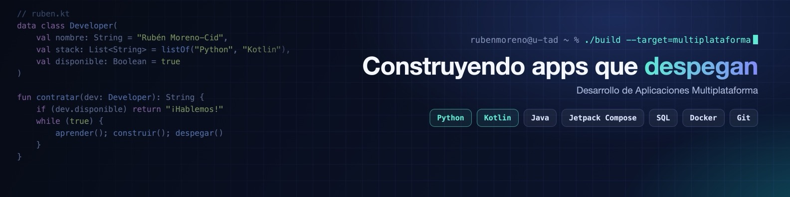

<!-- Portada (la misma que en LinkedIn) -->
<a href="https://www.linkedin.com/in/rubenmorenocid/">
  
</a>

<div align="center">

  <!-- Subtítulo animado -->
  <a href="https://git.io/typing-svg">
    
  </a>

  <br/>

  <!-- Contacto -->
  <a href="https://www.linkedin.com/in/rubenmorenocid/">
    
  </a>
  <a href="mailto:rubenmoreno.tech@gmail.com">
    
  </a>
  <a href="https://www.credly.com/badges/d9faeb66-141c-411d-9c76-c36ea19e2a9c">
    
  </a>
  <br/>
  
  

</div>

---

### 🚀 Sobre mí

```kotlin
data class Developer(
    val nombre: String = "Rubén Moreno-Cid",
    val estudios: String = "DAM · U-tad (2025-2027)",
    val antes: String = "Técnico de laboratorio y farmacia 🧪",
    val ahora: List<String> = listOf("Rotheos 🚁", "PrestaKey 🔑"),
    val aprendiendo: List<String> = listOf("Hibernate", "Sockets", "Concurrencia"),
    val extra: String = "Piloto de drones certificado (AESA A1/A3)",
    val disponible: Boolean = true
)
```

---

### 🛠️ Tecnologías

<div align="center">

**Lenguajes**<br/>


**Móvil**<br/>


**Bases de datos**<br/>


**Herramientas**<br/>


</div>

---

### 📂 Proyectos

<table>
  <tr>
    <td width="50%" valign="top">
      <h3>🚁 Rotheos</h3>
      <sub><b>TFG · 2º DAM · U-tad</b> · <i>en curso</i></sub>
      <p>App para pilotos de drones: hangar con operador, drones y documentos; spots con vídeo y comentarios; meteorología por ubicación; zonas de vuelo de ENAIRE y panel de administración.</p>
      
      
      
    </td>
    <td width="50%" valign="top">
      <h3>🔑 PrestaKey</h3>
      <sub><b>Proyecto Integrador · 2º DAM · U-tad</b> · <i>en curso</i></sub>
      <p>App Android para gestionar el préstamo y la devolución de llaves, con inicio de sesión y varias pantallas de gestión.</p>
      
      
      
    </td>
  </tr>
</table>

---

### 🏅 Certificaciones

<div align="center">
  <a href="https://www.credly.com/badges/d9faeb66-141c-411d-9c76-c36ea19e2a9c">
    
  </a>
  
  
  
</div>

---

### 📊 Estadísticas

<div align="center">
  
  
  <br/>
  
</div>

<!-- Ola final con los colores de la portada -->

