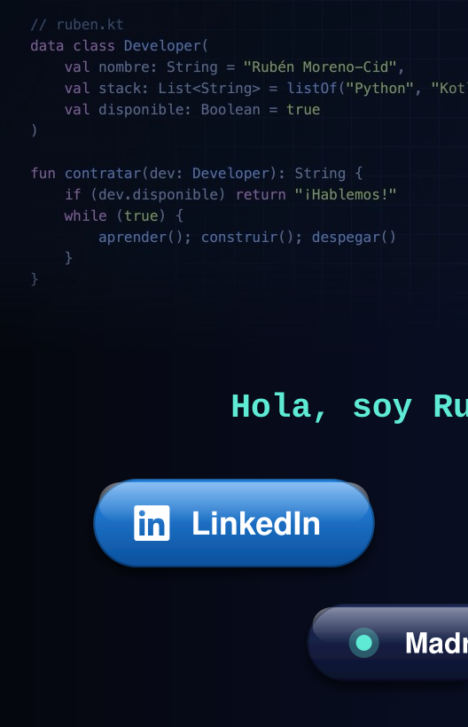
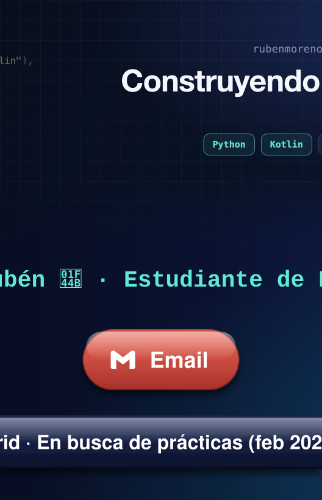
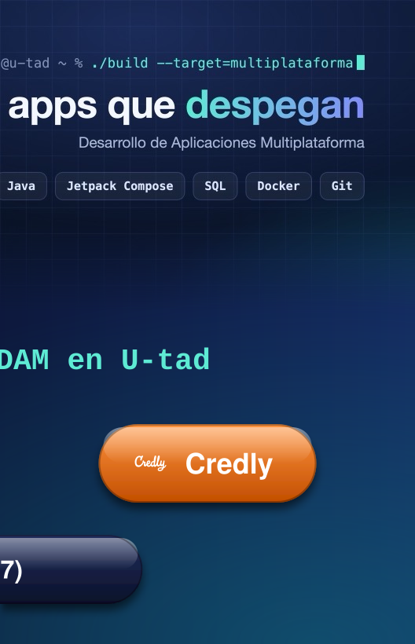

<!-- Cabecera: una imagen partida en 3 columnas, cada una con su enlace -->

---

### 🚀 Sobre mí

- 🎓 Estudiante de **DAM en U-tad** (2025-2027).
- 🧪 Vengo del mundo sanitario: **técnico de laboratorio y farmacia**. Ahora me dedico a lo que más me gusta: crear aplicaciones.
- 🔭 Desarrollando **Rotheos** (TFG) y **PrestaKey** (Proyecto Integrador).
- 🌱 Aprendiendo **Hibernate**, **sockets** y **programación concurrente** en Java.
- 🚁 Piloto de drones certificado (**AESA A1/A3**).

---

### 🛠️ Tecnologías

<table width="100%">
  <tr>
    <td align="center" width="415">
      
<b>💻 Lenguajes</b>

      <picture></picture>
    </td>
    <td align="center" width="415">
      
<b>📱 Móvil y frameworks</b>

      <picture></picture>
    </td>
  </tr>
  <tr>
    <td align="center" width="415">
      
<b>🗄️ Bases de datos</b>

      <picture></picture>
    </td>
    <td align="center" width="415">
      
<b>🧰 Herramientas</b>

      <picture></picture>
    </td>
  </tr>
</table>

---

### 📂 Proyectos

<table>
  <tr>
    <td width="50%" valign="top">
      <h3>🚁 Rotheos</h3>
      <b>TFG · 2º DAM · U-tad</b> · <i>en curso</i>
      
App para pilotos de drones: hangar con operador, drones y documentos; spots con vídeo y comentarios; meteorología por ubicación; zonas de vuelo de ENAIRE y panel de administración.

      <picture></picture>
      <picture></picture>
      <picture></picture>
    </td>
    <td width="50%" valign="top">
      <h3>🔑 PrestaKey</h3>
      <b>Proyecto Integrador · 2º DAM · U-tad</b> · <i>en curso</i>
      
App Android para gestionar el préstamo y la devolución de llaves, con inicio de sesión y varias pantallas de gestión.

      <picture></picture>
      <picture></picture>
      <picture></picture>
    </td>
  </tr>
</table>

---

### 🏅 Certificaciones

  
  <picture></picture>
  <picture></picture>
  <picture></picture>

---

### 📊 Estadísticas

  <picture></picture>
  <picture></picture>
   
  <picture></picture>

<!-- Ola final con los colores de la portada -->
<picture></picture>
